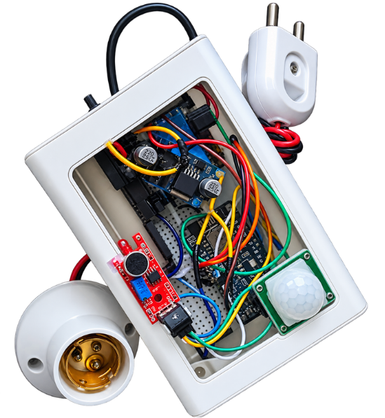
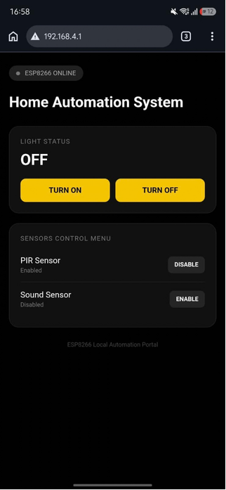
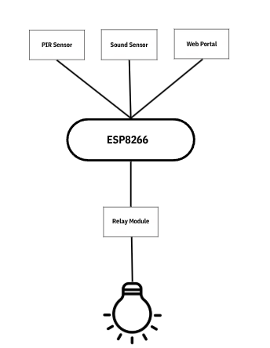

# 🏠 Smart Home Automation System using ESP8266

A Wi-Fi-based Smart Home Automation System developed using the **ESP8266 NodeMCU**. This project allows users to control household lighting through a locally hosted web portal while also providing automatic control using a PIR motion sensor and a sound sensor.

The ESP8266 creates its own Wi-Fi Access Point, allowing users to connect using a smartphone or computer and access the control dashboard through a web browser without requiring an internet connection.

---

## 📸 Project Gallery

### 1. Hardware Assembly



### 2. Web Control Portal



### 3. System Block Diagram



---

## 🚀 Features

- **Wi-Fi Access Point:** ESP8266 creates its own wireless network.
- **Web-Based Control:** Control the connected light through a browser.
- **Motion Detection:** PIR sensor detects human movement and toggles the light.
- **Clap Detection:** Sound sensor detects sound triggers and toggles the light.
- **Manual Control:** Turn the light ON or OFF using the web dashboard.
- **Independent Sensor Control:** Enable or disable PIR and sound sensors individually.
- **Offline Operation:** No external Wi-Fi router or internet connection required.
- **Real-Time Status:** Dashboard displays the current light and sensor states.

---

## 🧰 Components Required

| S.N. | Component | Quantity |
|---|---|---:|
| 1 | ESP8266 NodeMCU | 1 |
| 2 | PIR Motion Sensor | 1 |
| 3 | Sound Sensor Module | 1 |
| 4 | 1-Channel Relay Module | 1 |
| 5 | AC Light / Bulb | 1 |
| 6 | Jumper Wires | As required |
| 7 | Power Supply | 1 |
| 8 | Enclosure / Project Box | 1 |

---

## 🔌 Circuit Connections and Pinouts

The following pin mapping is used in the reconstructed Arduino sketch.

### ESP8266 NodeMCU Pin Configuration

| Component | Module Pin | ESP8266 NodeMCU Pin | GPIO |
|---|---|---|---|
| PIR Sensor | OUT | D5 | GPIO14 |
| Sound Sensor | DO | D6 | GPIO12 |
| Relay Module | IN | D1 | GPIO5 |
| PIR Sensor | VCC | 3.3V / Rated Supply | — |
| Sound Sensor | VCC | 3.3V / Rated Supply | — |
| Relay Module | VCC | According to Module Rating | — |
| All Modules | GND | GND | — |

**Important:** These assignments are the reconstructed sketch's pin configuration, not a confirmed record of the original physical wiring. Check your actual circuit before connecting the components.

### 1. PIR Motion Sensor

| PIR Pin | ESP8266 Connection |
|---|---|
| VCC | Appropriate supply voltage |
| OUT | D5 (GPIO14) |
| GND | GND |

The PIR sensor detects motion and sends a digital HIGH signal when motion is detected.

### 2. Sound Sensor

| Sound Sensor Pin | ESP8266 Connection |
|---|---|
| VCC | Appropriate supply voltage |
| DO | D6 (GPIO12) |
| GND | GND |

The digital output of the sound sensor is used to detect sound triggers such as claps.

### 3. Relay Module

| Relay Pin | Connection |
|---|---|
| VCC | According to relay module rating |
| GND | GND |
| IN | D1 (GPIO5) |

The relay acts as an electrically controlled switch for the connected light.

**Relay configuration:** The reconstructed sketch assumes an active-LOW relay. If your relay module uses active-HIGH logic, change the relay configuration in the code.

---

## ⚙️ Working Principle

The system operates through three main control methods:

### 1. Manual Control

The ESP8266 hosts a web portal that allows users to manually switch the connected light ON or OFF.

### 2. PIR-Based Automation

- When the PIR sensor detects a new motion event, it sends a digital signal to the ESP8266.
- The ESP8266 processes the signal.
- The relay changes state, toggling the light ON or OFF.

### 3. Sound-Based Automation

- The sound sensor detects a sound trigger, such as a clap.
- Its digital output is read by the ESP8266.
- The ESP8266 toggles the relay state.

### 4. Sensor Management

The web portal provides individual controls for both sensors.

- PIR sensor can be enabled or disabled.
- Sound sensor can be enabled or disabled.
- Disabling a sensor prevents it from controlling the light without physically disconnecting it.

---

## 🌐 Web Portal

The web portal is hosted directly on the ESP8266 using its built-in Wi-Fi functionality.

### Accessing the Dashboard

1. Power on the ESP8266.
2. Connect your smartphone or computer to the ESP8266 Wi-Fi network.
3. Open a web browser.
4. Enter the ESP8266 access point IP address.
5. Access the home automation dashboard.

### Default Wi-Fi Credentials

| Setting | Value |
|---|---|
| Wi-Fi SSID | HomeAutomation |
| Password | 12345678 |
| Default IP | 192.168.4.1 |
| Dashboard | http://192.168.4.1 |

The SSID and password can be modified in the Arduino source code.

---

## 💻 Software Requirements

- Arduino IDE
- ESP8266 Board Package
- ESP8266WiFi Library
- ESP8266WebServer Library

Both ESP8266 libraries are included with the ESP8266 Arduino Core.

### Uploading the Code

1. Install Arduino IDE.
2. Install the ESP8266 board package.
3. Connect the NodeMCU to your computer.
4. Select the appropriate ESP8266 board.
5. Select the correct COM/serial port.
6. Open `HomeAutomation.ino`.
7. Upload the program.

---

## 📁 Repository Structure

```text
home-automation/
│
├── HomeAutomation.ino
│
├── README.md
│
└── circuit/
    │
    ├── home_automation_box.png
    │
    ├── web_portal.png
    │
    └── block_diagram.png
```

---

## 🔒 Safety Precautions

- Use a relay module with appropriate voltage and current ratings.
- Never connect AC mains directly to ESP8266 GPIO pins.
- Keep all high-voltage connections properly insulated and enclosed.
- Disconnect the power supply before modifying the circuit.
- Have mains wiring checked and completed by a qualified person.

---

## 🎯 Project Objectives

The primary objective of this project is to develop an affordable and practical home automation prototype using an ESP8266 microcontroller.

It demonstrates the integration of embedded systems, wireless communication, sensor-based automation, relay switching and web-based device control.

---

## 🔮 Future Improvements

- Integration of additional home appliances.
- Energy consumption monitoring.
- Mobile-friendly interface improvements.
- Scheduling and timer-based automation.
- Integration with cloud-based IoT platforms.

---

## 👨‍💻 Author

**Manish Pathak**

Student | Space & Technology Enthusiast

🌐 Portfolio: [manishpathak369.com.np](https://manishpathak369.com.np)

---

## 📜 License

This project is available for educational and learning purposes. You are welcome to explore, modify and improve the implementation.

---

**Built with curiosity, electronics and code.** 🚀
